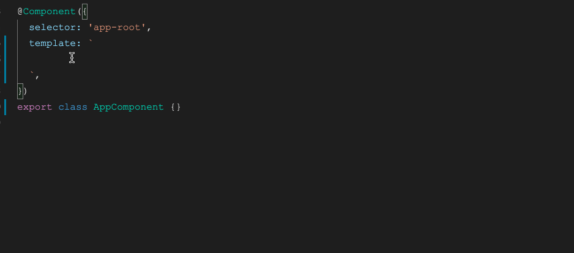

# ng-alain VSCode Snippets

[中文](README.zh-CN.md)

## Features

- Support class intellisense
- Support Class name hover introduction
- Extract i18n key
- Common Angular templates

## Usage

Typing the beginning of `nas-` will automatically appear in the intellisense list; no more!

## Configuration

| Name | Description | Type | Default |
|------|-------------|------|---------|
| `ng-alain-vscode.classMode` | CSS class autocomplete mode, `disabled`: off, `hover`: hover only, `enabled`: hover and completion | `disabled | hover | enabled` | `enabled` |
| `ng-alain-vscode.i18nStatus` | Whether to enable international quick fix, auto: When depend @angular/localize or @ngx-translate/core is enabled | `auto, enabled, disabled` | `auto` |
| `ng-alain-vscode.i18nPipeName` | Internationalization pipeline name | `string` | `i18n` |
| `ng-alain-vscode.i18nData` | Internationalization data | `Array<{ path: string, type: 'file' | 'node' | 'remote'}>` | `[{path: 'src/assets/tmp/i18n/zh-CN.json', type: 'file'}]` |
| `ng-alain-vscode.lessBuildPaths` | `paths` option of lesss compile | `string[]` | - |

## Support Language Versions

Support language list: English, 简体中文, will automatically switch according to the current the display language of VSCode.

> Abort how to changing the display language, pls refer to [Changing the Display Language](https://code.visualstudio.com/docs/getstarted/locales#_changing-the-display-language).
